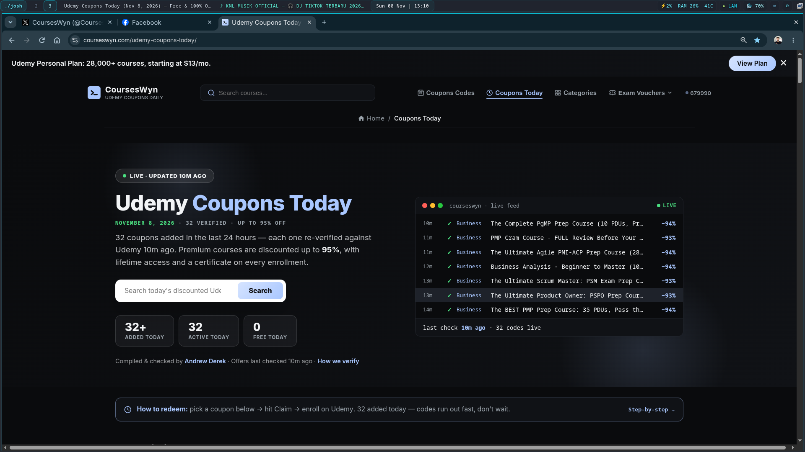
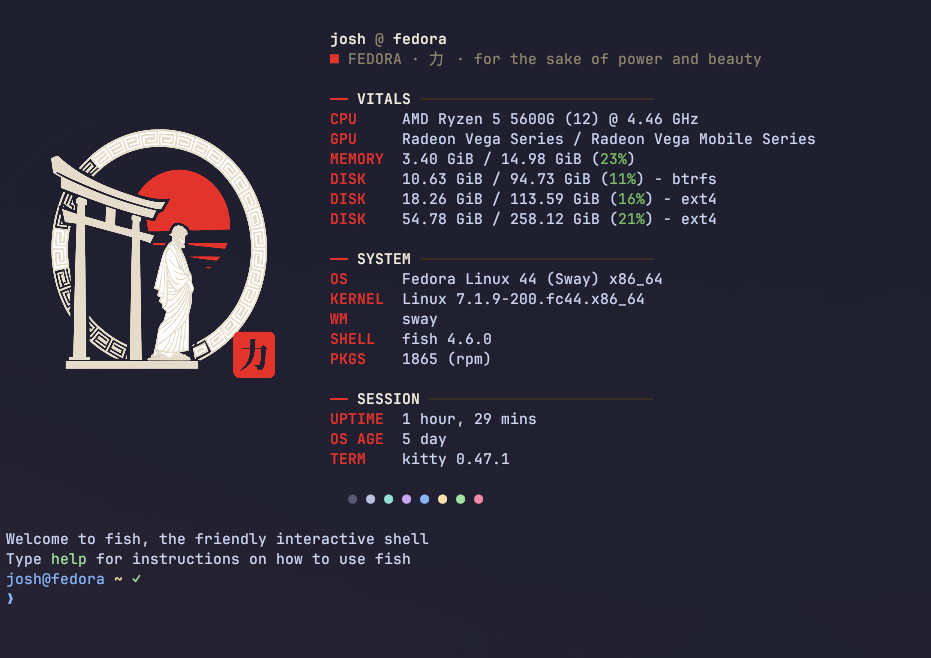

# Sway Ricing Dotfiles — Fedora 45 Sway



Dotfiles untuk desktop rice **Fedora 45 (Sway)** — yang sedang digunakan di
sistem live ini. Tema cyan-glass, bar ramping transparan, dan script helper
`fedora-*` untuk menu, jaringan, keybinds, dan rotasi wallpaper.

> Update terakhir: sinkron dari sistem live `/home/josh` pada Fedora 45 Sway
> (sway 1.12, waybar 0.15.0, fastfetch 2.68.1, Alacritty).

## Features

- **Sway** (`~/.config/sway/config`) — tiling WM, gaps 2px, cyan window
  colors, autostart `swaybg` + `waybar` + `mako` + `swayidle`, XWayland untuk
  aplikasi X11 (Chrome/LMStudio/dll).
- **Waybar** — top bar ramping (height 28, transparan, rounded pills):
  launcher, workspaces, window title, media (playerctl), clock
  (Asia/Jakarta), updates (dnf), sysinfo (CPU/RAM/suhu), net
  (`~/.local/bin/fedora-net`), pulseaudio, keybinds, power menu, tray.
- **Wofi** — launcher `Super+Space` / `Super+d`, style cyan-glass.
- **Alacritty** — terminal utama (`Super+Return`), opacity 0.85, font
  Noto Sans Mono 10, shell `fish -C fastfetch`.
- **Fastfetch** — ringkasan startup cyan (`SYSTEM / DESKTOP / HARDWARE /
  NETWORK` + modul *OS Age*).
- **Mako** — notifikasi Wayland.
- **Fish** — greeting kosong, `path` untuk `~/.opencode/bin`.
- **Helper `fedora-*`** di `~/.local/bin/`:
  - `fedora-menu` — command center (Super+Shift+Space)
  - `fedora-keybinds` — cheat-sheet keybinds (klik ikon keyboard di bar)
  - `fedora-net` / `fedora-net-menu` — status + menu jaringan
  - `fedora-rotate` — rotasi wallpaper otomatis (`--daemon/--once/--toggle`)
- **Wallpaper** — `~/.config/fedora-sway/wallpaper.png` + folder
  `~/.config/fedora-sway/wallpapers/` (diisi via `FEDORA_WALLPAPER_DIR`).

## Requirements

Di Fedora (pastikan session **Fedora Sway** dipilih di GDM):

```bash
sudo dnf install \
  sway waybar alacritty fastfetch btop fish wofi mako swaybg swaylock swayidle \
  pavucontrol playerctl brightnessctl grim slurp wl-clipboard thunar nm-connection-editor \
  firefox zed 2>/dev/null || true
sudo dnf install jetbrains-mono-fonts noto-sans-fonts fontawesome-fonts
```

> Ikon bar mengandalkan karakter Unicode/emoji bawaan (🔊 ⏻ ⌨ dll);
> font terminal/UI: *Noto Sans Mono* + *Noto Sans*.

## Install / Restore

Clone repo lalu salin `.config/` dan `.local/` ke home:

```bash
git clone https://github.com/Coutons/sway-ricing.git ~/dotfiles
cd ~/dotfiles
cp -r .config/* ~/.config/
cp -r .local/* ~/.local/
chmod +x ~/.local/bin/fedora-* ~/.config/waybar/scripts/*
```

Atau pakai [GNU stow](https://www.gnu.org/software/stow/):

```bash
git clone https://github.com/Coutons/sway-ricing.git ~/dotfiles
cd ~/dotfiles
stow -t ~ .config .local
```

Lalu restart sesi (log out/in) atau reload:

```bash
pkill -x waybar; waybar &
swaymsg reload   # dari dalam Sway
```

### Isi repo

```text
.config/
  sway/config
  waybar/{config,style.css,scripts/}
  wofi/{config,style.css}
  alacritty/alacritty.toml
  fish/config.fish
  fastfetch/config.jsonc
  mako/config
  fedora-sway/wallpaper.png
  gtk-3.0/settings.ini
  qt5ct/qt5ct.conf
  qt6ct/qt6ct.conf
.local/bin/
  fedora-menu, fedora-keybinds, fedora-net, fedora-net-menu,
  fedora-rotate, power-menu
wallpapers/            ← koleksi wallpaper lama (opsional)
screenshot.png
fastfetch.png
```

## Keybindings

Lihat `.config/sway/config` (`$mod` = Super) dan viewer `fedora-keybinds`.
Ringkasan singkat:

| Keys | Aksi |
|---|---|
| `Super+Return` | Terminal (alacritty) |
| `Super+d` / `Super+Space` | Launcher (wofi) |
| `Super+Shift+Space` | Command center (`fedora-menu`) |
| `Super+t` / `g` / `z` / `n` | Firefox / Chrome / Zed / Files |
| `Super+q` / `f` / `Shift+f` | Close / fullscreen / floating |
| `Super+1..0` | Workspace 1..10 |
| `Super+Shift+w` | Wallpaper berikutnya |
| `Print` / `Super+Print` | Screenshot penuh / region |
| `XF86Audio*` / `XF86MonBrightness*` | Volume / brightness |

## Screenshot

```bash
grim ~/dotfiles/screenshot.png
cd ~/dotfiles && git add screenshot.png && git commit -m "docs: update screenshot"
```

## Fastfetch



Jalankan `fastfetch` di terminal untuk lihat ringkasan saat ini.
Konfigurasi ada di `.config/fastfetch/config.jsonc`.

## Notes

Ini **pure dotfiles**. Yang di bawah disengaja **tidak** di-commit karena
terikat ke mesin / hasil generate:

- `*.bak.*`, `config.bak.*` — backup lokal Sway/Waybar
- `~/.config/fish/fish_variables`, `completions/`, `functions/` hasil lokal
- `~/.config/fedora-sway/wallpapers/` yang kosong (koleksi pribadi tetap di
  drive `Dataku/wallpaper`)

Jika reinstall dari nol, setup bagian system-level (GRUB `/etc/default/grub`,
release identity, boot entries `/boot/loader/entries/*.conf`) secara manual —
lihat `ryoku-sway/README.md` di folder backup lokal untuk dokumentasi restore
lengkap.
