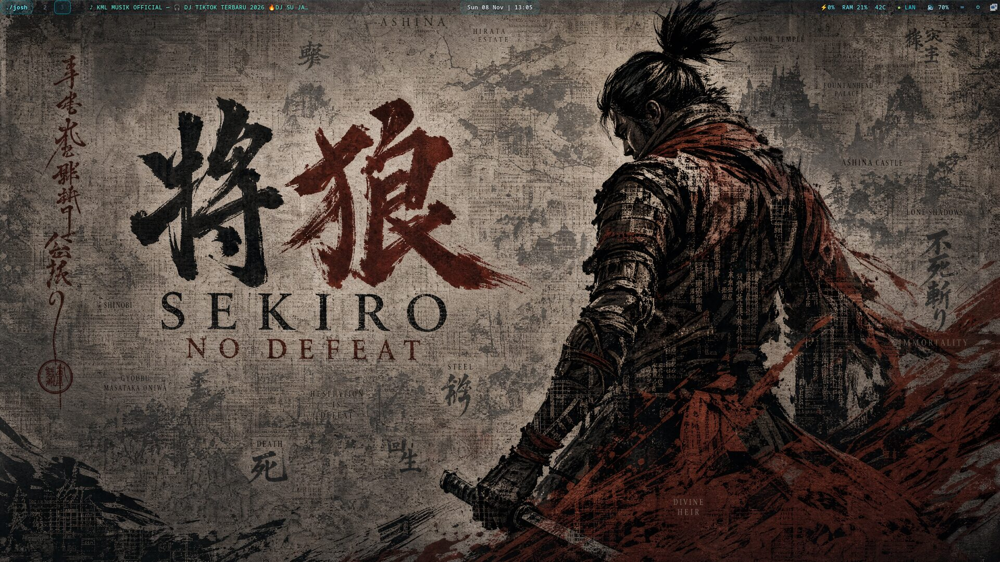
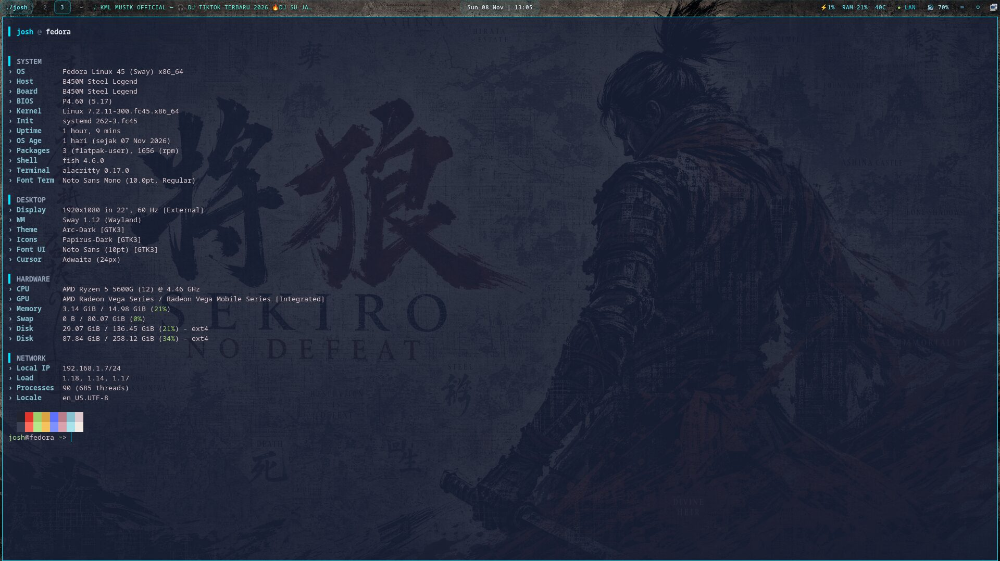

# Sway Ricing Dotfiles — Fedora 45 Sway



Dotfiles for a **Fedora 45 (Sway)** desktop rice — synced from the live
system on this machine. Cyan-glass theme, slim transparent bar, and
`fedora-*` helper scripts for menu, network, keybinds, and wallpaper rotation.

> Synced from the live system on Fedora 45 Sway
> (sway 1.12, waybar 0.15.0, fastfetch 2.68.1, Alacritty).

## Features

- **Sway** (`~/.config/sway/config`) — tiling WM, 2px gaps, cyan window
  colors, autostart `swaybg` + `waybar` + `mako` + `swayidle`, XWayland
  for X11 apps (Chrome, LMStudio, etc.).
- **Waybar** — slim top bar (height 28, transparent, rounded pills):
  launcher, workspaces, window title, media (playerctl), clock
  (Asia/Jakarta), updates (dnf), sysinfo (CPU/RAM/temp), net
  (`~/.local/bin/fedora-net`), pulseaudio, keybinds, power menu, tray.
- **Wofi** — launcher `Super+Space` / `Super+d`, cyan-glass style.
- **Alacritty** — main terminal (`Super+Return`), 0.85 opacity, Noto Sans
  Mono 10 font, shell `fish -C fastfetch`.
- **Fastfetch** — cyan startup summary (`SYSTEM / DESKTOP / HARDWARE /
  NETWORK` + *OS Age* module).
- **Mako** — Wayland notifications.
- **Fish** — empty greeting, `path` for `~/.opencode/bin`.
- **`fedora-*` helpers** in `~/.local/bin/`:
  - `fedora-menu` — command center (Super+Shift+Space)
  - `fedora-keybinds` — keybind cheat-sheet (click the keyboard icon in the bar)
  - `fedora-net` / `fedora-net-menu` — network status + menu
  - `fedora-rotate` — automatic wallpaper rotation (`--daemon/--once/--toggle`)
- **Wallpaper** — `~/.config/fedora-sway/wallpaper.png` + folder
  `~/.config/fedora-sway/wallpapers/` (filled via `FEDORA_WALLPAPER_DIR`).

## Requirements

On Fedora (make sure the **Fedora Sway** session is selected in GDM):

```bash
sudo dnf install \
  sway waybar alacritty fastfetch btop fish wofi mako swaybg swaylock swayidle \
  pavucontrol playerctl brightnessctl grim slurp wl-clipboard thunar nm-connection-editor \
  firefox zed
sudo dnf install jetbrains-mono-fonts noto-sans-fonts fontawesome-fonts
```

> Bar icons rely on built-in Unicode/emoji (🔊 ⏻ ⌨ etc.);
> terminal/UI fonts: *Noto Sans Mono* + *Noto Sans*.

## Install / Restore

Clone the repo and copy `.config/` and `.local/` into your home:

```bash
git clone https://github.com/Coutons/sway-ricing.git ~/dotfiles
cd ~/dotfiles
cp -r .config/* ~/.config/
cp -r .local/* ~/.local/
chmod +x ~/.local/bin/fedora-* ~/.config/waybar/scripts/*
```

Or use [GNU stow](https://www.gnu.org/software/stow/):

```bash
git clone https://github.com/Coutons/sway-ricing.git ~/dotfiles
cd ~/dotfiles
stow -t ~ .config .local
```

Then restart the session (log out/in) or reload:

```bash
pkill -x waybar; waybar &
swaymsg reload   # from inside Sway
```

### Repo layout

```text
.config/
  sway/config
  waybar/{config,style.css,scripts/}
  wofi/{config,style.css}
  alacritty/alacritty.toml
  fish/config.fish
  fastfetch/config.jsonc
  mako/config
  fedora-sway/wallpaper.png
  gtk-3.0/settings.ini
  qt5ct/qt5ct.conf
  qt6ct/qt6ct.conf
.local/bin/
  fedora-menu, fedora-keybinds, fedora-net, fedora-net-menu,
  fedora-rotate, power-menu
screenshot.jpg
fastfetch.jpg
```

## Keybindings

See `.config/sway/config` (`$mod` = Super) and the `fedora-keybinds`
viewer. Quick summary:

| Keys | Action |
|---|---|
| `Super+Return` | Terminal (alacritty) |
| `Super+d` / `Super+Space` | Launcher (wofi) |
| `Super+Shift+Space` | Command center (`fedora-menu`) |
| `Super+t` / `g` / `z` / `n` | Firefox / Chrome / Zed / Files |
| `Super+q` / `f` / `Shift+f` | Close / fullscreen / floating |
| `Super+1..0` | Workspace 1..10 |
| `Super+Shift+w` | Next wallpaper |
| `Print` / `Super+Print` | Full / region screenshot |
| `XF86Audio*` / `XF86MonBrightness*` | Volume / brightness |

## Screenshot


## Fastfetch



Run `fastfetch` in the terminal to see the current summary.
Config lives in `.config/fastfetch/config.jsonc`.

## Notes

This is **pure dotfiles**. The following are intentionally **not**
committed because they are machine-specific / generated:

- `*.bak.*`, `config.bak.*` — local Sway/Waybar backups
- `~/.config/fish/fish_variables`, `completions/`, `functions/` — local state
- `~/.config/fedora-sway/wallpapers/` when empty (private collection stays
  on the `Dataku/wallpaper` drive)

For a from-scratch reinstall, set up the system-level parts manually
(GRUB `/etc/default/grub`, release identity, boot entries
`/boot/loader/entries/*.conf`).
